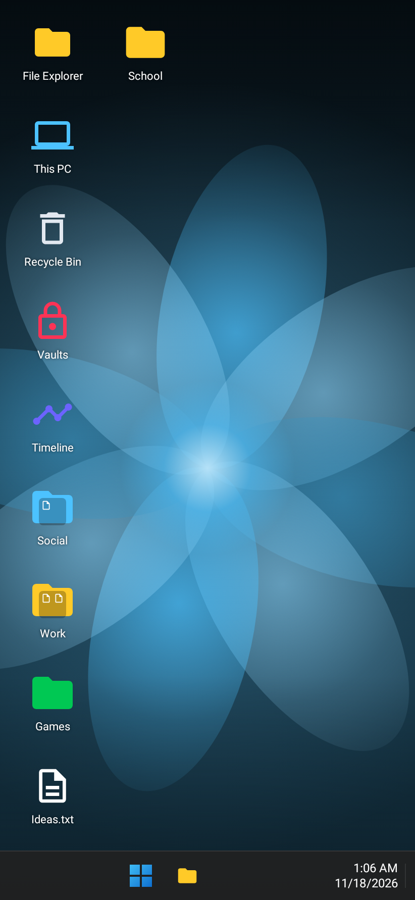
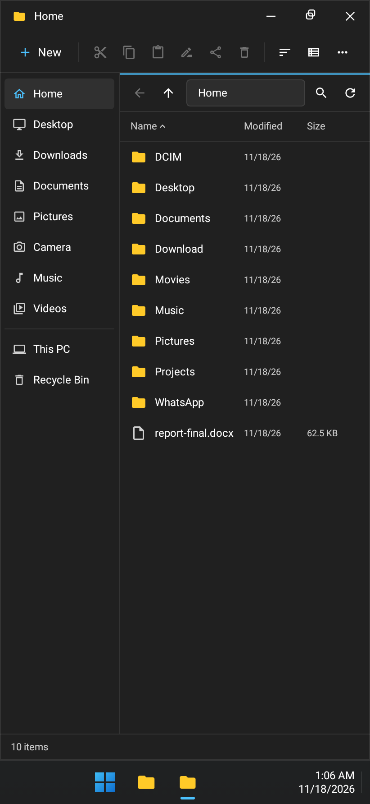
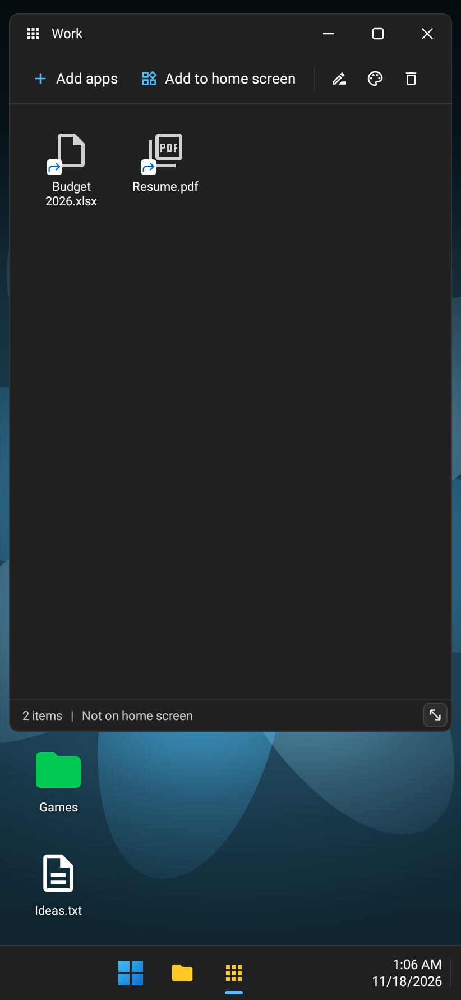
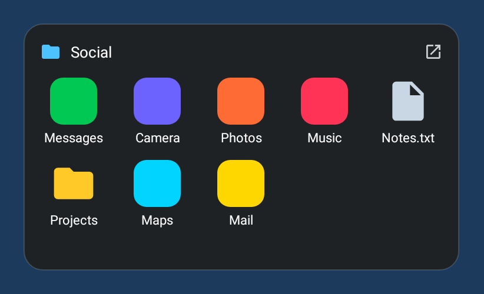
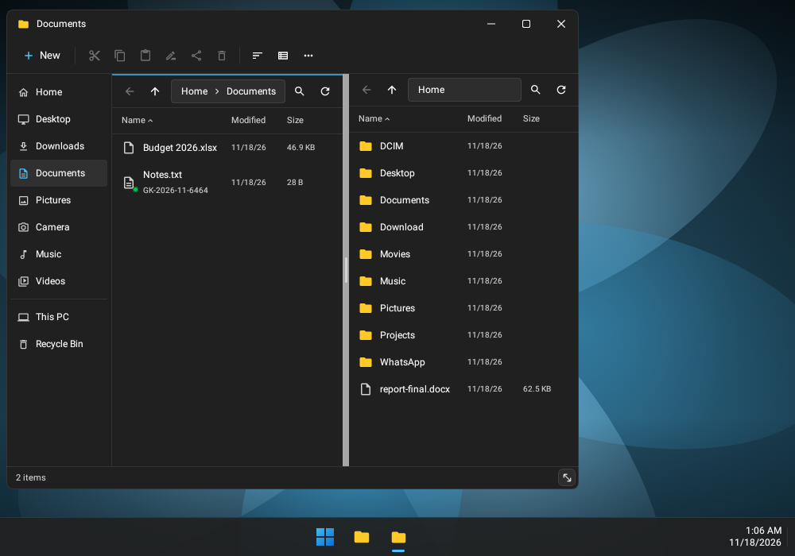

# Ghost Key File Explorer: native Android app

A native Kotlin/Jetpack Compose rebuild of Ghost Key File Explorer. It uses
the **NeverSoft 11 File Explorer interface** (Windows 11 layout: command bar,
breadcrumb address bar, navigation pane, details list, status bar, Recycle Bin,
Mica window chrome, Bloom wallpaper, taskbar) and folds in **all of Ghost
Key's features**. It also adds a **home-screen widget** that puts your folders
of apps on your phone's home screen.

| Phone desktop | Explorer | App folder | Widget |
|---|---|---|---|
|  |  |  |  |



## Home-screen folder widgets

- **App folders** hold apps *and* shortcuts to files or folders. Create them
  from the desktop (long-press → New app folder), the explorer's **New** menu,
  or the widget picker.
- **Put one on your home screen**: open the folder and tap **Add to home
  screen**, or long-press your home screen → Widgets → Ghost Key → pick a
  folder. Place as many widgets as you like, each with its own folder.
  Long-press a placed widget to switch which folder it shows.
- Tap an app in the widget to launch it. Tap a file to open it, or a folder to
  open it in Ghost Key. Tap the widget's title to open the folder in Ghost Key.
- Widgets update the moment you change a folder in the app.

## Drag and drop

One system covers the whole app. Long-press and drag:

| Drag… | onto… | does |
|---|---|---|
| files/folders (or a multi-selection) in a pane | a folder row, the other pane, a breadcrumb, a sidebar location | move (or copy, see View → Drag & drop copies) |
| files from an explorer window | empty desktop | move them to your `Desktop` folder |
| desktop files | an explorer window or a desktop folder | move them there |
| files | an app folder icon / app folder window | add shortcuts to the folder (files stay put) |
| apps from **Start → All apps** | an app folder | add the app |
| an app inside a folder | another app folder icon | move it between folders |
| an app inside a folder | another item in the same folder | reorder |
| files | Recycle Bin | delete (restorable) |
| an app folder item | Recycle Bin | remove it from the folder |

Android does not let any app drag icons off the phone's own launcher, so
organizing happens on the Ghost Key desktop and the widgets mirror it.

## Explorer features

- NeverSoft layout: command bar (New, Cut, Copy, Paste, Rename, Share, Delete,
  Sort, View, More), Back/Forward/Up, breadcrumbs (drop targets too), Refresh,
  search, navigation pane (Home, Desktop, Downloads, Documents, Pictures,
  Camera, Music, Videos, This PC, Recycle Bin, Limbo), details columns
  (sortable), status bar with free space.
- **Dual panes**: side by side on wide screens, stacked on phones, with a
  draggable splitter (double-tap to balance).
- Multi-select (long-press, then tap to add), Details / Large icons views
  with image thumbnails, hidden items toggle, shared clipboard across windows.
- Recycle Bin with Restore, including Android's own system trash.
- Per-folder color and icon (stored in the app, never written into folders).
- Search by name under the current folder, or by tag: `who:alice`,
  `where:whatsapp`, `GK-2026-05`.
- Several windows: minimize, maximize, resize, and long-press drag to move.

## Ghost Key intelligence, ported natively

- **Properties & tags**: SKU (`GK-YYYY-MM-XXXX`), who/what/when/where
  auto-tags, manual tags, flagging. Tags, SKUs and colors follow files when
  they're moved or renamed.
- **SKU magnetism**: link files manually, or auto-link files that share a
  who/where tag.
- **Analysis**: phones, emails, links, platforms, dates, keywords, risk score,
  pattern detection.
- **Timeline**: every action, grouped by day, filter chips, activity spikes.
- **Vaults**: real AES-256-GCM encryption of file contents (PBKDF2-SHA256
  key, chunked so large files work, tamper-evident). Standard / Forensic
  (never removes originals, keeps SHA-256 and chain of custody) / Ephemeral
  (self-wipes after 24 h). Unlocked keys are dropped when you leave the app.
- **Limbo**: ZIPs open into an isolated workspace with path-escape,
  duplicate, collision, size and zip-bomb checks. Browse and edit the
  workspace, analyze it, drag single files out, or **Repackage & place**:
  the rebuilt ZIP is verified entry by entry (CRC32) before it's written.

No background scanning, no network, no account. Everything stays on the device.

## Build

```bash
cd native
./gradlew assembleRelease          # app/build/outputs/apk/release/app-release.apk
./gradlew testDebugUnitTest        # crypto, Limbo, file ops, drag & drop UI tests
./gradlew testDebugUnitTest -Pscreenshots --tests '*ScreenshotTest*'   # refresh docs/screenshots
```

App ID `com.ether4o4.ghostkey`, so it installs **next to** the older
Capacitor build instead of replacing it. Signed with the committed
self-signed key in `signing/` so every build updates the previous install;
set `GK_KEYSTORE_PATH`, `GK_KEYSTORE_PASSWORD`, `GK_KEY_ALIAS` and
`GK_KEY_PASSWORD` to use your own key.

Requires Android 10+. Grant **All files access** on first launch.
